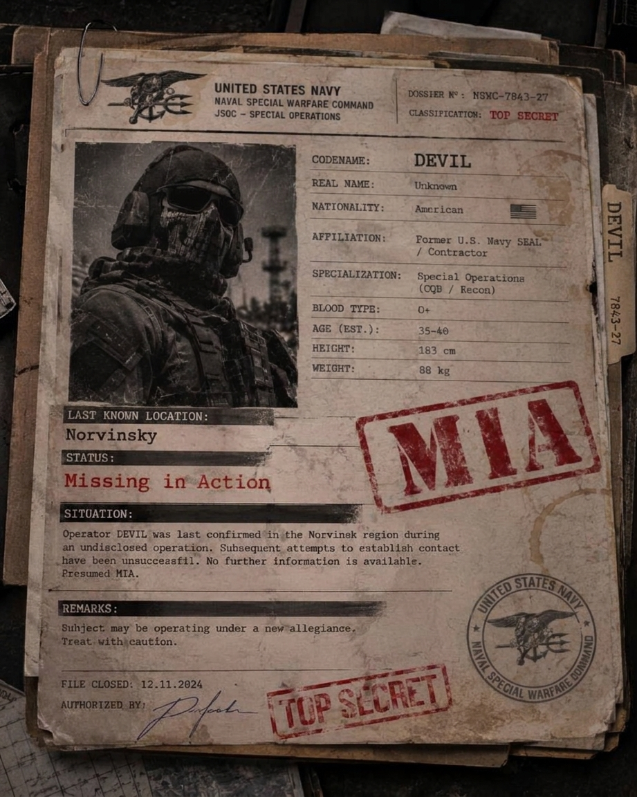

# devil-cultist-operator
A custom Cultist boss mod for SPT 4.1.6, featuring an original character with a former U.S. Navy SEAL background. Powered by CommonLib, SAIN and MoreBotsAPI.

# DEVIL – Cultist Operator

  

  <b>A former Navy SEAL. A missing operator. A new identity.</b>

---

## Overview

**Devil Cultist Operator** is a custom boss mod for Single Player Tarkov (SPT), introducing DEVIL, an original Cultist operator with a military background in the United States Naval Special Warfare community.

Combining the background of a former special operations operator with the mysterious nature of the Cultists, DEVIL brings a new character and combat presence to Tarkov.

## Background – DEVIL

| Field | Information |
|---|---|
| Codename | DEVIL |
| Nationality | American |
| Former affiliation | United States Navy SEALs |
| Previous occupation | Private Military Contractor |
| Current affiliation | Unknown |
| Last known location | Norvinsk |
| Status | MISSING IN ACTION (MIA) |

### The Missing Operator

Before disappearing in Norvinsk, DEVIL served as a United States Navy SEAL before transitioning into the private military and security sector.

His military background and operational experience eventually brought him to the Norvinsk region, where he became involved in an undisclosed operation.

Following the collapse of the region and the escalation of hostilities, all attempts to establish contact with the operator failed.

His last confirmed location was Norvinsk.

DEVIL was subsequently classified as **Missing in Action (MIA)**.

No confirmed information regarding his whereabouts or activities has been recovered since.

His military file remains incomplete.

Whatever happened to DEVIL in Norvinsk is still unknown.

---

## Project Architecture

The project is divided into three separate components:

### 1. Server

The server-side component handles the backend implementation of DEVIL.

Responsibilities include:
- Server-side bot registration.
- Bot configuration and database integration.
- Spawn-related logic.
- Integration with server-side dependencies.

### 2. Prepatch

The Prepatch component handles modifications that must be applied during the prepatching stage.

It provides the necessary compatibility and runtime modifications required by the project.

### 3. Client

The client-side component handles DEVIL's in-game integration.

It provides the client-side functionality required by the mod and its dependencies.

---

## Dependencies

The project uses the following libraries and APIs:

- **SPT 4.1.6**
- **WTT-CommonLib**
- **SAIN**
- **Big Brain**
- **MoreBotsAPI**
- **WTT-Artem**

Make sure the required dependencies are installed and compatible with your SPT version.

## Installation

1. Download the latest release.
2. Extract the mod files.
3. Install the components in their corresponding SPT directories.
4. Install all required dependencies.
5. Launch SPT and verify that the mod loads correctly.

Refer to the release package for the component-specific installation structure.

## Development

| Property | Value |
|---|---|
| Project | Devil Cultist Operator |
| Author | Shaw |
| Version | 1.0.0 |
| GUID | `spt.shaw.devil` |
| SPT Version | 4.1.6 |
| Faction | Cultists |
| WildSpawnType | `960234` |

## Credits

- **Shaw** – Project author and developer.
- **CommonLib** – Shared modding library.
- **SAIN** – AI framework.
- **MoreBotsAPI** – Bot registration and integration API.

## License

This project is licensed under the MIT License. See the [LICENSE](LICENSE) file for details.
